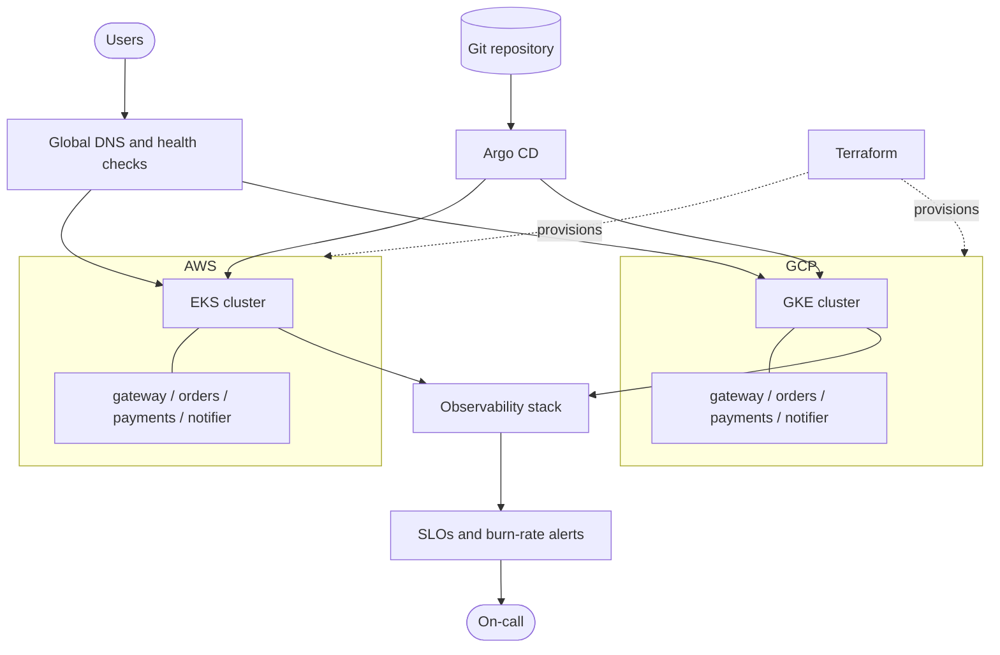

# Architecture overview

## Context

The platform hosts a small e-commerce style workload on Kubernetes in two clouds. Its purpose is to provide a realistic environment for practising platform engineering and SRE: provisioning, delivery, observability, reliability targets and incident response. Users reach the system through a public API; operators interact with it through Git, dashboards and alerts.

## Components

| Component | Description |
| --- | --- |
| Terraform | Provisions VPC/VNet-level networking, clusters and IAM on AWS and GCP. State is remote and per environment. |
| EKS and GKE | One managed Kubernetes cluster per cloud, running the same workloads. |
| Argo CD | Hub that reconciles platform and application manifests from Git onto both clusters. |
| Cluster add-ons | Ingress, cert-manager, external-dns, autoscaling. |
| Applications | `gateway`, `orders`, `payments`, `notifier`. |
| Observability | Metrics, logs, traces, dashboards, SLO rules and alert routing. |
| Security baseline | Policy engine, external secrets, network policies, least-privilege identity. |
| Global traffic routing | DNS-based routing with health checks across both clusters. |

## Diagram

## Multi-cloud rationale

The aim is not to claim that every workload should span clouds. The aim is to practise the skills multi-cloud demands: cloud-agnostic abstractions where they pay off, honest handling of differences where they do not, and operating a service whose failure domain is larger than one provider. Running both also exposes portability assumptions early and enables cross-cloud failover exercises. The trade-offs are recorded in [ADR-0002](../adr/0002-multi-cloud-strategy.md).

## Reliability model

Each service defines SLIs and SLOs in [`docs/slo`](../slo). Alerts are based on error budget burn rate over multiple windows. Budget exhaustion changes engineering priorities according to a written policy.

## Failure scenarios to demonstrate

1. Loss of a node pool or availability zone in one cluster.
2. Full regional or cluster outage on one cloud, with traffic shifting to the other.
3. Latency injection or errors from the `payments` dependency, exercising timeouts, retries and circuit breaking.
4. Message backlog growth in `notifier` and recovery under back-pressure.
5. Bad deployment caught by progressive delivery and rolled back automatically.
6. Configuration drift or manual change reverted by Argo CD self-heal.
7. Certificate expiry or DNS misconfiguration.
8. Observability pipeline degradation, verifying alerting on missing data.
9. Credential or secret rotation under load.

Each exercise produces a runbook update and, where appropriate, a postmortem in [`docs/postmortems`](../postmortems).

## Related decisions

- [ADR-0002](../adr/0002-multi-cloud-strategy.md) Multi-cloud strategy
- [ADR-0003](../adr/0003-gitops-with-argo-cd.md) GitOps with Argo CD
- [ADR-0004](../adr/0004-terraform-module-and-state-conventions.md) Terraform conventions
- [ADR-0005](../adr/0005-observability-stack-choice.md) Observability stack
